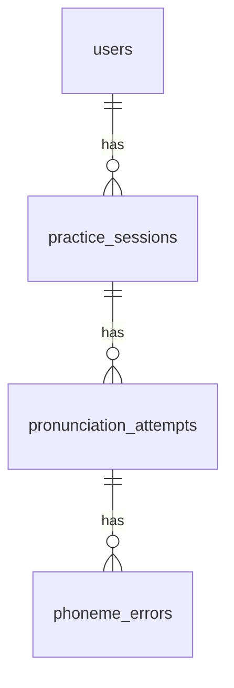

# Thiết kế cơ sở dữ liệu

Ứng dụng lưu dữ liệu cục bộ bằng SQLite (`lib/data/database/app_database.dart`). Bài luyện nằm trong mã nguồn (`exercise_catalog.dart`) nên các bảng chỉ lưu `exercise_id`.

| Bảng | Mục đích | Cột chính |
| --- | --- | --- |
| `users` | Hồ sơ người học, mục tiêu và lịch nhắc | `name`, `daily_goal_minutes`, `reminder_enabled`, `reminder_hour`, `reminder_minute` |
| `practice_sessions` | Một lần mở bài luyện có ít nhất một lần đọc | `user_id`, `exercise_id`, `local_date`, `duration_seconds` |
| `pronunciation_attempts` | Kết quả của từng lần đọc | `session_id`, `expected_text`, `recognized_text`, `score`, `phoneme_accuracy`, `confidence` |
| `phoneme_errors` | Từng âm sai trong một lần đọc | `attempt_id`, `word`, `expected_phoneme`, `actual_phoneme` (NULL nghĩa là thiếu âm) |

Các quyết định thiết kế:

- `local_date` lưu ngày theo giờ máy tại thời điểm luyện, nên streak không phụ thuộc múi giờ UTC.
- Streak được tính từ các ngày có `practice_sessions`, không lưu thành cột riêng nên không thể lệch với lịch sử.
- Khóa ngoại dùng `ON DELETE CASCADE`: xóa hồ sơ sẽ xóa toàn bộ dữ liệu của người đó.
- Có chỉ mục trên `(user_id, local_date)`, `session_id` và `attempt_id` cho các truy vấn thống kê.
